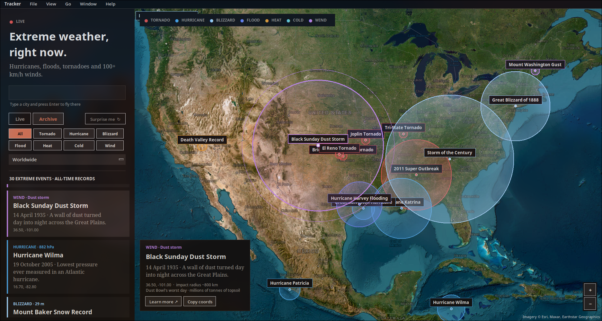

# Extreme Weather Tracker

A dark desktop app that maps hurricanes, floods, tornado warnings and 100+ km/h winds on a
satellite map, plus an archive of the most extreme weather events ever recorded.

## Install (Arch Linux)

    sudo pacman -S --needed python tk python-requests python-pillow
    git clone https://github.com/fsrvr/weather-ab && cd weather-ab
    python main.py

Other systems: `pip install -r requirements.txt` (needs Tk).

## Usage

- **Live tab**: pick a month and year with the wheel. The current month is live. Tick
  "Search the whole year" to cover every month of that year.
- **Archive tab**: about 30 of the greatest events ever (EF5 tornadoes, record hurricanes,
  blizzards, heat and cold records). Filter by type.
- **Continent**: limit results to one continent and fly there (both tabs, also under View).
- **Map**: drag to pan, scroll to zoom at the mouse, click an event for its size, track and facts.
- **Menu bar**: Export events as JSON, Surprise me, previous/next month, fullscreen, usage.
- **Shortcuts**: Ctrl+F search a city, Ctrl+Q quit, Esc deselect.

## Data sources

- NASA EONET: storms and floods
- US National Weather Service: tornado and extreme wind alerts (live)
- Open-Meteo: wind gusts and rainfall
- Esri World Imagery: satellite map
- Local archive: about 30 hand-picked record events built into main.py

## Notes

Track lines on historic storms are approximate. Not for safety decisions; use official warnings.

