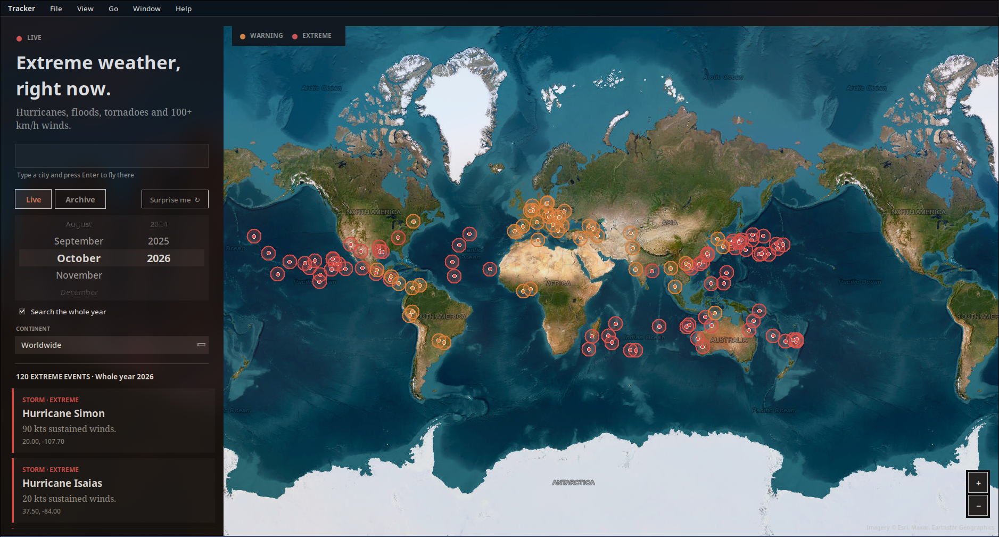

# Extreme Weather Tracker

A dark desktop app that maps hurricanes, floods, tornado warnings and 100+ km/h winds on a
satellite map, plus an archive of the most extreme weather events ever recorded.

## Install

Requires Python 3.9+ with Tk, plus `requests` and `pillow`.

```bash
git clone https://github.com/fsrvr/weather-ab && cd weather-ab
```

**Arch Linux**

```bash
sudo pacman -S --needed python tk python-requests python-pillow
python main.py
```

**Debian / Ubuntu**

```bash
sudo apt install python3 python3-tk python3-pip python3-venv
python3 -m venv .venv && source .venv/bin/activate
pip install -r requirements.txt
python main.py
```

**Fedora**

```bash
sudo dnf install python3 python3-tkinter python3-pip
python3 -m venv .venv && source .venv/bin/activate
pip install -r requirements.txt
python main.py
```

**macOS** (Homebrew)

```bash
brew install python python-tk
python3 -m venv .venv && source .venv/bin/activate
pip install -r requirements.txt
python main.py
```

**Windows** (Python from python.org, Tk is included)

```powershell
py -m venv .venv
.venv\Scripts\activate
pip install -r requirements.txt
python main.py
```

On Linux/macOS you can also run `./run.sh` (after `chmod +x run.sh`).

## Usage

- **Live tab**: pick a month and year with the wheel. The current month is live. Tick
  "Search the whole year" to cover every month of that year.
- **Archive tab**: about 30 of the greatest events ever (EF5 tornadoes, record hurricanes,
  blizzards, heat and cold records). Filter by type.
- **Continent**: limit results to one continent and fly there (both tabs, also under View).
- **Map**: drag to pan, scroll to zoom at the mouse, click an event for its size, track and facts.
- **Menu bar**: Export events as JSON, Surprise me, previous/next month, fullscreen, usage.
- **Tutorial**: shown on first launch, reopen with F1 or Help > Tutorial.
- **Shortcuts**: Ctrl+F search a city, Ctrl+Q quit, Esc deselect.

## Data sources

- NASA EONET: storms and floods
- US National Weather Service: tornado and extreme wind alerts (live)
- Open-Meteo: wind gusts and rainfall
- Esri World Imagery: satellite map
- Local archive: about 30 hand-picked record events built into main.py

## Notes

Track lines on historic storms are approximate. Not for safety decisions; use official warnings.




